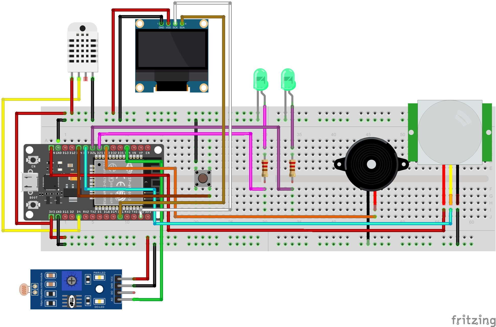

# Catatan Desain SmartRoom

SmartRoom adalah monitor ruangan berbasis ESP32 yang membaca suhu, kelembapan, cahaya, dan gerak, memberi alarm bila suhu melewati batas, dan mengirim data ke MQTT.

## Keputusan desain

- **ESP32 DevKit** dipilih karena WiFi bawaan, sehingga telemetri MQTT tidak butuh modul tambahan.
- **Sensor:** DHT22 (suhu dan kelembapan), modul LDR (cahaya, pin analog 34 di ADC1 yang aman dipakai bersama WiFi), dan PIR (gerak).
- **Keluaran:** OLED SSD1306 lewat I2C (SDA 21, SCL 22), LED hijau dan merah dengan resistor 220 Ω, buzzer, dan satu tombol acknowledge ke GND dengan `INPUT_PULLUP` agar tanpa resistor eksternal.
- **Firmware modular:** `sensor`, `alarm`, `display`, dan `net` dipisah. Modul saling terhubung lewat callback, jadi `alarm` tidak perlu tahu MQTT.
- **Alarm dibuat tahan gangguan:** histeresis 0,5 °C agar tidak berkedip di sekitar batas, debounce tombol 50 ms, dan nilai DHT dianggap rusak setelah 3 kali gagal berturut-turut.
- **Koneksi:** WiFi dan MQTT reconnect otomatis, ada status `offline` (LWT), dan batas alarm bisa diubah lewat perintah MQTT.

## Masalah yang ditemui

1. **Lolos di Wokwi, gagal di Arduino IDE.** Build di Windows berhenti dengan `redefinition of 'struct SensorData'`. Penyebabnya `network.h` buatan sendiri tertukar dengan `Network.h` bawaan core ESP32 3.1.1, karena Windows tidak membedakan huruf besar-kecil, sedangkan Wokwi berjalan di Linux. Solusinya mengganti nama file menjadi `net.h` dan `net.cpp`. Build setelahnya berhasil: 75% flash dan 14% RAM.
2. **Perintah `pio` tidak dikenali** di Git Bash. Build dijalankan lewat ikon PlatformIO di VS Code, dan hasilnya `[SUCCESS]`.
3. **Perbedaan simulasi dan alat asli.** Kode yang jalan di simulator belum tentu cocok dengan perangkat keras, misalnya pull-up DHT22 dan arah nilai LDR.

## Jika ada waktu lebih

- **Koneksi MQTT tidak memblokir loop.** Saat broker tidak terjangkau, `connect()` bisa menahan program sampai beberapa detik sehingga tombol terasa mati.
- **Keamanan:** pakai broker pribadi dengan autentikasi. Broker publik membuat siapa pun yang tahu topik bisa mengubah batas alarm.
- **Alarm saat sensor rusak:** sekarang status alarm bertahan di nilai terakhir. Perlu status error yang jelas.
- **Uji di perangkat asli:** pull-up 10 k untuk DHT22, kalibrasi LDR, dan pembacaan pertama yang kini baru muncul setelah 5 detik.
- **Pengujian otomatis:** build CI sudah disiapkan, tetapi belum pernah dijalankan.
